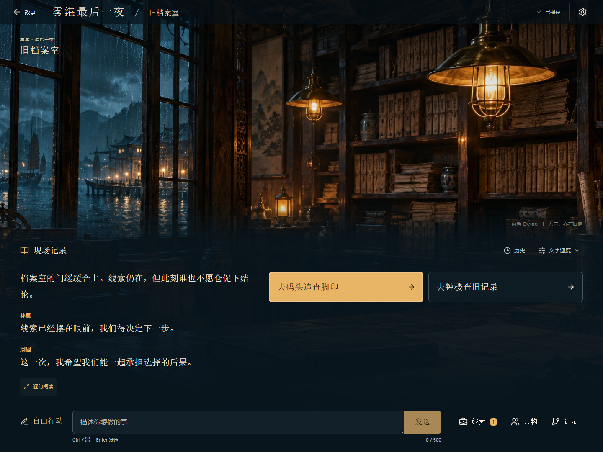

# 演示录屏

[观看实际浏览器录屏（WebM）](demo.webm)



2026-10-22，使用 Windows 的独立 PostgreSQL `stage5_demo_test`、标准 `scripts/start-local.ps1`、本机 Next.js 开发页面与无头 Edge 录制，73.52 秒、1440×1080、无声。当前源码也已单独完成静态生产构建。录像是自动操作真实界面的结果，未拼接或生成替代界面，不包含密钥输入或私人故事；已用 Edge 实际播放至结束，媒体错误为空。

顺序：故事库 → Demo 开局 → 旧档案室调查与线索 → 刷新恢复地点/草稿 → 码头 → 灯塔三个结局 → 原节点回放 → 钟楼新分支 → 同时保留所有分支。共 14 个截图检查点，三个结局与回放读取后均断言保存的完整节点 JSON 不变；预算前后一致，供应商调用增量为零。

**Demo 是预写内容，录屏只展示产品界面与存档能力，不是 AI 质量证据。** R1 的真实模型来源及人工核查见[阶段五报告](../evaluation/2026-10-22-stage-5-results.md)。

复现录制：先按仓库 README 在独立 `_test` 数据库启动应用。演示后端不要配置任何供应商密钥。另开终端安装仅用于录屏的依赖到忽略目录：

```powershell
npm install --prefix ./runtime/stage5/tools playwright
$env:PLAYWRIGHT_MODULE = (Resolve-Path './runtime/stage5/tools/node_modules/playwright').Path
$env:PLAYWRIGHT_BROWSERS_PATH = Join-Path (Get-Location) 'runtime/stage5/browsers'
node ./runtime/stage5/tools/node_modules/playwright/cli.js install ffmpeg
node scripts/record-demo.mjs --base-url http://localhost:3000 --api-url http://127.0.0.1:8000
```

脚本使用独立无头 Edge，不读取日常浏览器配置；需本机已安装 Edge。输出新的 `runtime/stage5/demo-<时间戳>/demo.webm`、检查点 PNG 与不含凭据的 evidence.json，已有目录不会覆盖。本次使用桌面环境提供的同版 Playwright 依赖和 FFmpeg，原始文件仍保存在本机忽略目录。
