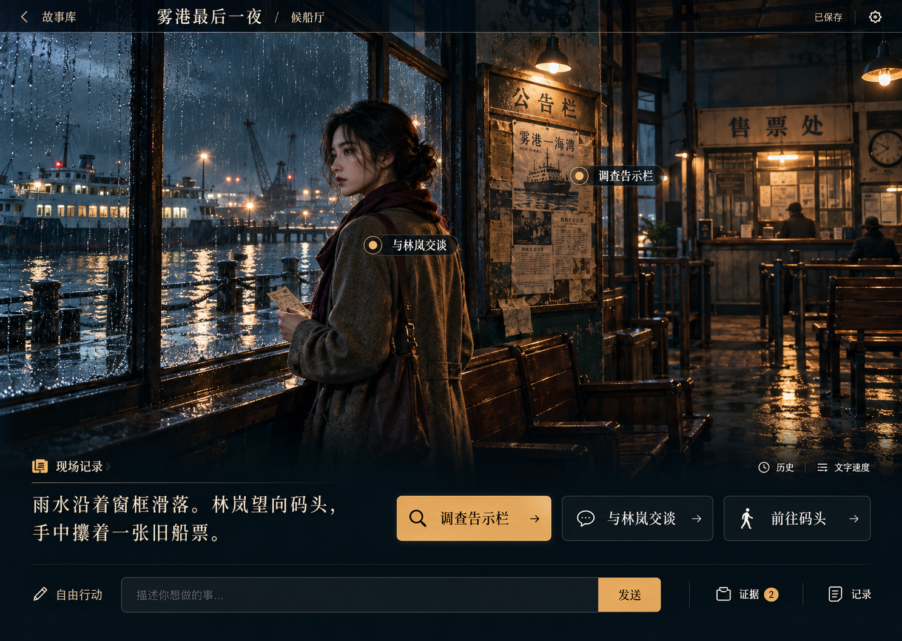

# 阶段 3 UI 设计：电影舞台

日期：2026-10-13

状态：**用户已于 2026-10-13 确认。首轮现有故事游玩页已实施并通过本地自动检查与 Demo 浏览器验证；阶段 3 完整流程仍待后续接入。**

设计依据：[需求](../01-requirements.md) · [技术设计](../02-technical-design.md) · [阶段 3 范围与验收](../03-development-plan.md#阶段-3图片前端与存档)

实施结果与验证边界见[实施日志](../development-log/2026-10-13-cinematic-ui.md)和[视觉检查](../../design-qa.md)。手机设计集中在第 10 节；图片裁切、自由输入和全宽弹层分别见第 5、7、8 节。

## 1. 设计结论与本次交付边界

用户已选择三张设计图中的第一张“电影舞台”，并要求先提供 UI 设计文档，再开发可实际操作的响应式前端页面。

本次首先交付**游玩主页面及其必需的辅助面板**：全屏场景、剧情阅读、后端行动选项、自由输入、人物资料、已知线索、历史、分支回放、阅读设置和现有模型设置。沿用现有 Next.js 静态导出项目，直接改造已有页面；不另建演示项目。

主页面先接入当前前端已支持的内置 Demo／旧 DeepSeek 会话。自定义故事的创建、配图准备和跨浏览器重启故事库属于后续阶段 3 接入任务；本文规定它们与主页面的视觉和交互衔接，但不把这些能力算作本次单页完成条件，也不把模拟响应当真实后端功能。

成功标准：第一眼与已选图保持一致；用户能通过真实后端行动走到结局、回退并探索分支；手机上能读完整剧情并完成操作；辅助内容不长期挤占舞台。

## 2. 唯一视觉参考

原始生成图尺寸为 1487 × 1058；设计以约 1440 × 1024 的桌面视口为基准，实际按可用空间适配。图中的“调查告示栏”“与林岚交谈”“前往码头”、船票等内容属于视觉示例，**不是对当前故事事实、按钮或可用证据的新增定义**。

保留的特征：

- 背景直接铺满舞台，雨夜海港、青黑阴影与暖灯形成层次；去掉旧页面大卡片包围插画的结构。
- 顶栏轻薄，左侧返回／故事入口，中部故事标题和地点，右侧保存状态及设置。
- 剧情和行动集中在画面底部。底部承托区具有足够深的底色，保证文字可读。
- 人物和调查对象成为场景中的轻量入口；不能靠装饰热点捏造可执行行动。
- 米白文字与克制的琥珀色强调，边框细、圆角小，不堆叠浮动卡片。

## 3. 信息层级与桌面布局

| 区域 | 设计规则 | 主要内容 |
|---|---|---|
| 顶栏 | 高约 56px；左右内边距 32–48px；覆盖场景但不遮挡关键主体 | 故事入口、标题、当前地点、保存状态、设置 |
| 场景 | 宽度铺满；在 1440 × 1024 下约占上方 65%–72%；主体焦点可随图片配置 | 当前地点背景、在场人物／合法行动入口 |
| 阅读工具行 | 位于剧情区上缘，轻量线性图标，最小点击区域 44px | 现场记录、历史、文字速度 |
| 阅读与行动 | 桌面约 43% / 57% 两栏；32px 间隔；内容过长时自然增高 | 已保存叙述／对白、全部可执行选项 |
| 底部操作行 | 顶部分隔线；常规高度约 80px；不覆盖正文 | 自由行动输入、发送、线索、人物、记录 |

布局遵循内容高度。长对白、错误提示或放大文字出现时，页面可纵向滚动；不能为了复刻截图而把操作压到视口之外，也不强制固定高度。

行动多于三个时按原顺序换行，不能只保留前三个。第一项用琥珀填充强调可操作性，其余使用深色描边；视觉强调不代表系统推荐结局或暗示最优答案。

## 4. 视觉规范

| 项目 | 取值与用途 |
|---|---|
| 页面底色 | `#08151D`，图片未加载时仍有完整结构 |
| 面板底色 | `#10212B`；抽屉和弹窗使用接近不透明的底色 |
| 正文 | `#F4EBDD` |
| 次要文字 | `#B6C4C7`，需在实际背景上检查对比度 |
| 强调色 | `#E8B466`，主按钮、选中状态、焦点提示 |
| 分隔线 | `#45545B`，避免每个段落都加边框 |
| 错误 | 深红底与浅红文字，配文字说明，不能仅靠颜色区分 |
| 标题／剧情字体 | 系统宋体系列：`Songti SC`、`SimSun`、serif；不依赖在线字体 |
| 控件字体 | `Microsoft YaHei`、system-ui、sans-serif |
| 字号 | 桌面标题 26–30px，剧情 22–26px；控件 16px，辅助文字不小于 12px |
| 行高 | 剧情 1.7–1.85；控件约 1.5 |
| 间距 | 以 4/8px 为基础，常用 12、16、24、32、48px |
| 圆角 | 按钮／输入 6–8px；面板 12px |
| 图标 | 复用现有 Lucide 线性图标，细节与参考图接近；不新增第二套图标依赖 |
| 动效 | 轻量 160–240ms 状态过渡；无强制镜头摇动、视差或循环闪烁 |

图片负责场景美术，文字和按钮使用真实 HTML。不能把整张设计图作为背景再用透明点击区域冒充页面。暗色遮罩仅承托文字，不代替场景素材。

## 5. 场景与素材

- 内置故事的候船厅、旧档案室、码头、钟楼、灯塔各有匹配背景；三个结局复用清晨海港素材。
- 保持电影写实／轻绘画质感、阴冷环境与暖色灯光；人物身份、服装与故事年代一致。
- 素材为独立图片，移除设计稿里的导航、正文、按钮和热点文字。优先使用 WebP，首屏图优先加载，后续地点按需加载。
- 手机裁切保留人物和主要环境，桌面保留横向空间。每张图设置独立焦点；不能把文字嵌进背景以规避响应式布局。
- 本轮生图素材用于内置 Demo 美术或设计参考，不代表应用已经接通 CogView-4。
- 自定义故事将使用固定的五张背景与三张人物素材。不得把雾港人物或地点图直接套到古代／未来新故事上。
- 图像加载失败时展示可读的“场景图片暂时无法加载”和重试入口；剧情与已有合法行动仍可使用。

## 6. 剧情阅读

1. 默认显示当前保存节点的叙述及对白，不改写正文、不删减已批准内容。
2. 提供“即时／标准／慢速”文字速度；标准和慢速只控制本地显示，不产生模型请求。
3. 点击正文显示当前句全文；全文已显示时点击继续下一句。提供可见的下一句按钮及句序提示，最后一句不自动执行剧情行动。
4. “展开本幕”可一次阅读整幕，长文自然换行；“历史”读取当前节点与祖先的保存内容。
5. 已读内容可随时重看。阅读动画不锁住行动；提交行动时以用户明确点击或发送为准。
6. 减少动画开启后直接显示完整文字。尊重系统 `prefers-reduced-motion`；阅读偏好可以持久化，供应商密钥不进入这些存储。

R1 新故事的 `dialogue=[]` 是正常情况：界面以“现场记录”呈现 narration，不虚构发言者或补生成对白。旧故事存在角色对白时显示保存的角色名和原文。

## 7. 行动、热点与自由输入

### 后端行动选项

- 按钮文本、ID、顺序来自当前节点的公开选项，点击通过现有行动接口提交。
- 只有公开协议能明确绑定目标时，才把同一行动显示为人物／物体热点；热点与底部按钮共享同一提交路径。
- 当前旧 Demo 未提供调查目标绑定，不用“调查告示栏”替换其真实选项。场景中的人物入口可打开公开人物资料，不能伪装成对话行动。
- 地点切换仅通过已提供的合法移动选项，不能点击背景就直接改变地点。

### 自由行动

- 输入区有持续可见的“自由行动”标签、描述性占位文案、字数提示，最多 500 字；空白输入不能发送。
- 手机允许多行输入。Enter 换行，Ctrl/Cmd + Enter 发送；发送按钮始终可触达。
- 提交期间显示“正在处理你的行动”，禁用重复提交和节点切换；保留已提交输入，成功保存后才清空。
- 请求失败或任务中断保留输入和父节点。明确展示“重新连接任务”或“重新提交”，不能通过刷新界面伪造成功。
- 同一未确认任务的网络重连复用已有任务与幂等键；只有用户明确发起新的尝试才创建新键。

### 提交状态

| 状态 | 用户看到的反馈 | 可执行操作 |
|---|---|---|
| 可操作 | 当前保存内容和行动选项 | 选择、输入、查看辅助面板 |
| 提交中 | 处理中状态，按钮禁用 | 阅读当前内容 |
| 读取已批准结果 | 批准内容可逐步显示 | 不提前开放下一回合提交 |
| 连接中断 | 明确说明正在恢复／需要重新连接 | 恢复同一任务 |
| 任务失败／中断 | 原父节点、保留的输入、具体错误 | 按任务终态允许重试 |
| 保存成功 | “已保存”，更新地点与分支记录 | 继续行动或回放 |

## 8. 辅助面板

桌面使用右侧抽屉，宽约 400–460px；窄屏使用全宽弹层。一次只打开一个主面板，背景不可误操作；关闭后焦点回到触发按钮。

| 面板 | 内容与行为 | 边界 |
|---|---|---|
| 已知线索 | 只展示当前节点公开、已发现的内容；为空时显示“尚未获得线索” | 旧 Demo 仅能显示公开状态所支持的线索记录，不捏造证据物品 |
| 人物 | 当前公开姓名、身份和可知资料 | 不展示隐藏秘密、未披露动机；不添加未经证实的信任分数 |
| 历史 | 当前节点祖先链的保存叙述和对白，按时间顺序 | 不混入兄弟分支，读取不调用生成器 |
| 分支记录 | 保存节点、地点、原行动标签、当前选中标识 | 选中旧节点读取原文；“从这里继续”明确创建新分支 |
| 阅读设置 | 字速、减少动画 | 不改变保存文本 |
| 模型设置 | 沿用当前本地设置流程，配置状态与错误可见 | API Key 仅送后端内存；OpenAI 继续禁用 |

后续接入自定义调查协议时，线索面板允许先选择已知证据，再从当前合法目标中选择出示对象；只有后端给出合法 evidence/target 对应关系时才启用提交。

### 故事入口

完整故事库尚未接入前，顶栏使用“故事”打开当前故事概览，提供“继续游玩”和现有新建入口；不冒充已可切换多局的故事库。开始新局前保留现有切换存档提示。

后续跨会话持久化验收后再改为“故事库”，保存每局凭据、当前位置及待处理任务。关闭浏览器后恢复不能由当前 sessionStorage 的刷新恢复推断。

## 9. 结局与回放

- 结局在同一舞台中呈现，使用保存的结局标题与正文，复用素材，不新增自动模型调用。
- 正文下提供“查看分支”“返回上一幕”“开始新局”；终局不显示可发送的自由输入。
- 回放状态明确显示“正在回看”，保留选中节点和原内容；返回已保存节点不重新生成。
- 从非终局历史节点执行新行动即产生分支，不覆盖旧节点。不提供容易与回放混淆的无说明“重新生成”按钮。
- 不能提前展示尚未达到的结局标题、达成条件或完整证据链。

## 10. 响应式布局

| 视口 | 布局 |
|---|---|
| ≥ 1200px | 电影舞台完整横向构图；底部阅读与行动两栏；输入和工具同一行 |
| 768–1199px | 场景占可用上方空间；阅读与行动根据宽度逐步改为上下排列；工具可换行 |
| < 768px | 顶栏简化为故事入口、标题、设置；地点显示在场景角落；场景约 42–48svh，最低约 280px；正文、行动、输入顺序纵向排列 |
| 低高度横屏 | 减小场景最小高度，允许整页滚动；不使用锁死的全屏高度 |

窄屏动作按钮通栏，辅助工具四项以内分组排列。弹层内容可滚动，关闭按钮常驻顶部。软键盘打开时输入框和发送按钮随可见区域可达；底部尊重安全区。

验收宽度：360、390、768、1024、1440px；补充 844 × 390 横屏。浏览器放大至 200% 后不丢操作、不横向溢出。

## 11. 可访问性与状态反馈

- 所有核心操作可用键盘完成，焦点清晰，点击区域至少 44 × 44px。
- 输入框有 label；图标按钮有可访问名称；图片有适当替代文字；纯装饰图标不重复朗读。
- 对话框进入时接收焦点、内部约束焦点、Esc 关闭、关闭后恢复焦点。运行任务的危险切换保持禁用并说明原因。
- 动态状态以适量 `aria-live` 提示，逐字动画不逐字打断屏幕阅读器；辅助技术可读取完整批准内容。
- 正文对比度至少 4.5:1；不只依赖颜色区分选中、失败、忙碌或结局。
- 初始连接失败显示具体错误与重试入口；空数据、加载、图片失败都有完整可读结构。

## 12. 与后续阶段 3 页面衔接

以下定义完整流程的一致性，不意味着本次单页实现同时交付全部功能：

| 页面／状态 | 核心内容 | 进入下一步的条件 |
|---|---|---|
| 故事库 | 内置 Demo、已有故事、当前进度、待恢复任务 | 有合法会话凭据，恢复对应节点或任务 |
| 创建故事 | 背景、年代、已开放模型，明确费用提示 | 提交真实创建任务 |
| 设定确认 | 无剧透简介、确认按钮、返回修改入口 | 服务器批准并固定设定 |
| 准备图片 | 五场景／三人物的实际完成数量与失败说明 | 八张固定素材全部就绪 |
| 游玩舞台 | 本文主页面 | 服务端许可行动，结果提交后展示 |
| 结局／回放 | 已保存结局、节点和分支 | 读取固定内容与素材 |

准备进度来自真实任务，不使用虚构百分比或倒计时。图片部分失败时保留已批准设定及成功素材，只提供补缺恢复。当前后端确认故事即建根节点；正式接入自定义故事舞台前，须补服务端准备状态与行动准入，不能只靠前端隐藏按钮阻止提前游玩。

## 13. 实施顺序与验收门槛

1. **确认本文与第一版视觉目标。** 根据反馈修订本文件后再开始代码开发。
2. **改造现有游玩页。** 沿用现有 API，先完成响应式舞台、真实行动和阅读交互；检查选项不被改写，失败输入保留。
3. **接入辅助面板。** 验证历史只读祖先、分支回放、人物／线索公开边界、设置及键盘焦点。
4. **完成素材与视觉比对。** 用同视口参考图和浏览器截图比较；检查桌面、窄屏、长文、错误和终局状态。
5. **运行验证并记录。** 前端测试、`npm run typecheck`、`npm run build`；真实 Demo 操作、回退分支、刷新恢复；开发日志记录实际结果。

本次单页验收必须覆盖：

- 无密钥 Demo 正常进入，并用真实后端完成三个结局及一次新分支。
- 行动、自由输入、历史、回放和设置不是静态装饰；未接入能力不显示可用假入口。
- 失败保留输入；未确认任务不重复创建；回放无模型调用。
- 长剧情、无对白、多选项、空线索、连接失败、图片失败均可读可操作。
- 指定视口无横向溢出、控件重叠、不可达发送按钮；减少动画与键盘完整流程通过。
- 与选定图保持场景主导、轻顶栏、底部阅读／行动的视觉层级。

阶段 3 整体验收仍须另行完成自定义故事、CogView-4、共享原子预算、跨浏览器恢复及三年代完整实际游玩；本次 UI 通过不替代这些门槛。

## 14. 本次核查与决策说明

- 当前参考代码：`frontend/components/Theater.tsx`、`frontend/store/story.ts`、`frontend/lib/api.ts`、`frontend/components/LocalSettingsDialog.tsx`。
- 当前前端读取旧 `/world` 与单会话 sessionStorage；新调查世界使用需认证的 `/session/world?node_id=...`。二者不得混用。
- 当前 UI 在发送前清空输入，后续改造须修正为成功提交后清空。
- 当前旧场景画面由 SVG 绘制，后续替换为真实美术素材；服务器文本、状态与节点保持权威。
- 本文选择“先交付已有后端可用的主页面，再接完整新故事流程”，以符合用户此次要求的响应式单页范围；代价是首轮不会完成整个阶段 3。
- 当前全局文档的少量“阶段 2 未验收”表述滞后，阶段 2 最新状态以主开发计划和 2026-10-11 最终验收报告为准。本文不修改历史验收记录。
