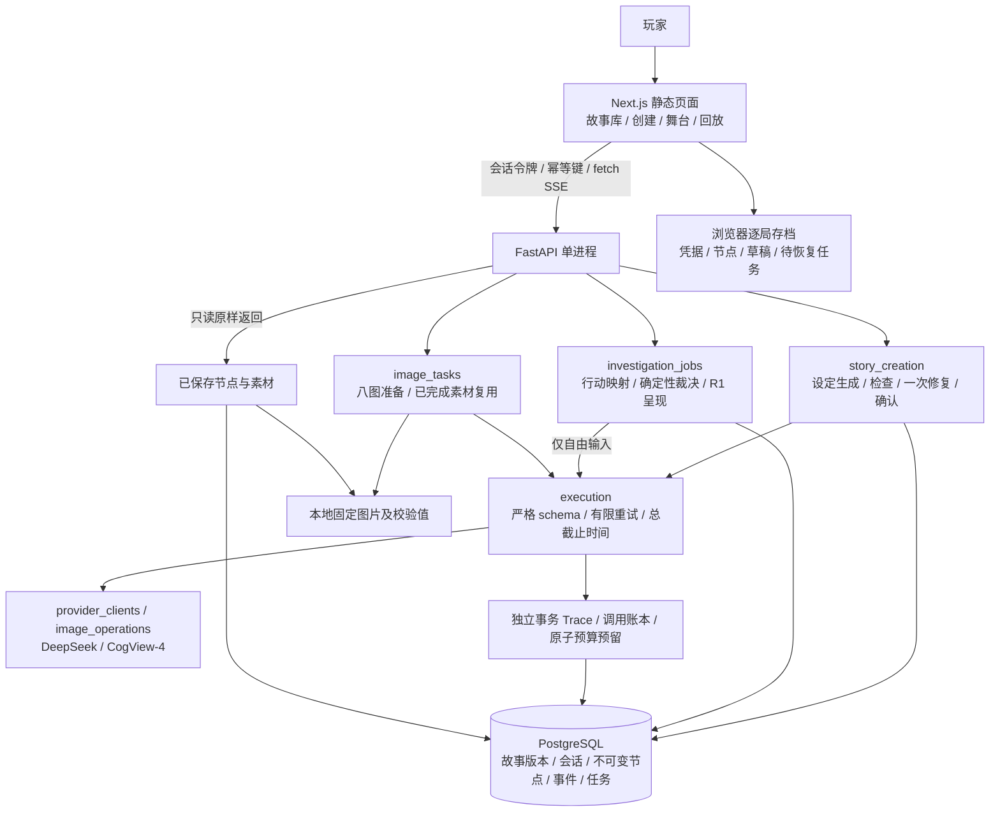
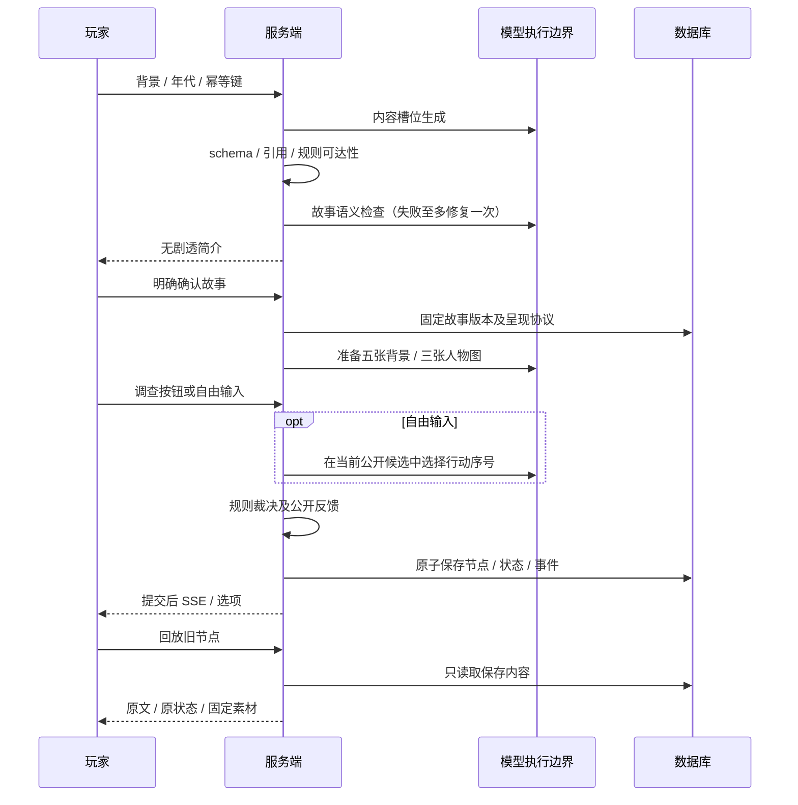

# 作品说明：AI 即兴剧场

本地单人调查叙事游戏。AI 在固定调查结构内生成故事内容与配图，理解玩家自由输入；服务端确定行动结果并保存不可变分支。当前新故事使用 `controlled-content-2 / approved-feedback-1`，回合直接呈现创建时已审核的反馈。按钮游玩与旧节点回放不调用模型；自由输入仍需 DeepSeek。

OpenAI 文字支持与多 Agent 已于 2026-10-22 按用户决定取消。项目不声称拥有自主 NPC、开放行动空间或每轮实时生成对白。三个角色包含主角与两位 NPC，五个地点、三个结局的规则结构由服务器冻结。

## 实际架构

Docker 交付为 Nginx 静态前端及同源 `/api` 代理、FastAPI、普通 PostgreSQL 三个服务。仅网页端口映射到宿主机回环地址；数据库与素材卷持久化。源码直接安装路径继续可用。

## 创建与调查

## 可以验证的工程能力

- **模型输出边界**：独立版本化操作，严格输入/输出校验；模型不能改写规则或直接提交世界状态。
- **状态与分支**：同地点多轮调查，移动独立裁决；新分支只使用选中父节点与祖先。旧版本走兼容路径。
- **失败恢复**：任务幂等、批准后 SSE、重连补发、显式恢复；失败保留输入和父状态，不伪造成功节点。
- **预算与审计**：文字/图片共享预留，80 CNY 提醒、100 CNY 停止；Trace 与失败用量独立持久化。估算不等于供应商账单。
- **本地交付**：静态页面、逐局恢复、Docker 独立卷和源码运行。API Key 仅进入后端内存，不进入存档或浏览器持久化。

相关代码：[`story_creation.py`](../../backend/app/story_creation.py)、[`investigation_jobs.py`](../../backend/app/investigation_jobs.py)、[`execution.py`](../../backend/app/execution.py)、[`execution_traces.py`](../../backend/app/execution_traces.py)、[`budget.py`](../../backend/app/budget.py)。

## 展示与证据

- [阶段五设计与指标边界](../superpowers/specs/2026-10-22-stage5-portfolio-design.md)
- [阶段二真实与一位用户验收](../evaluation/2026-10-11-stage-2-approved-feedback-results.md)
- [阶段三范围与已知限制](../evaluation/2026-10-18-stage-3-closeout.md)
- [Docker 实际验收](../evaluation/2026-10-21-stage-4-docker-results.md)

适合使用的作品描述：实现本地调查叙事引擎，将 AI 故事内容生成、行动理解和固定配图接入严格校验与确定性规则；支持不可变分支存档、任务恢复、可追溯调用与共享预算。具体成功率、耗时、费用与评审人数必须附对应版本和报告。

已知限制：故事共享调查结构；自然语言只能选择受支持行动；新故事多数回合无动态对白；自动配图有已记录视觉偏差，手机实机未测。历史小样本与一位评审不能推广为全部故事或所有用户的质量结论。
